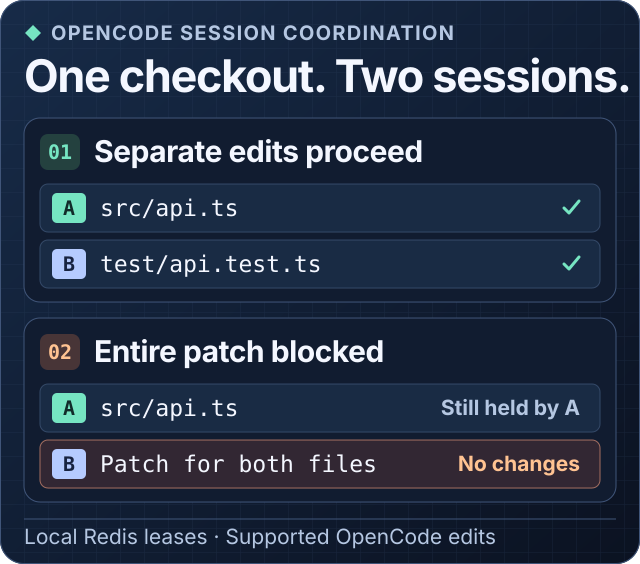

# Agents Shared Context

**Run multiple OpenCode sessions in one repo without stepping on each other’s edits.**

An OpenCode plugin that lets agents see who’s working, reserve files, and wait for a handoff. No extra worktree or terminal integration required.

[Quick start](#quick-start) · [Session controls](#working-with-other-sessions) · [Privacy and limits](#privacy-and-limits)



## When it helps

- **Split a change.** One session renames a method while another updates its tests. Both can edit different files. If a supported patch touches a file held by the other session, the plugin blocks the entire patch and names the holder.
- **Hand off a file.** Check who’s working with `coord_who`. If you need a file another session holds, ask your agent to claim it with `wait: true`. The plugin waits and reserves it when it becomes free; the agent doesn’t have to poll.
- **Verify the result.** Ask your agent for a stable-source build. The plugin lets tracked work finish, holds new coordinated edits, and releases protection after the foreground build.

**Scope:** This coordinates supported OpenCode operations, not external editors or arbitrary shell writes. If local Redis is unavailable, ordinary edits proceed with a warning, subject to OpenCode permissions.

## Quick start

Tested with OpenCode **2.3.2**. Building from source requires Node.js 22 or newer and npm. Git identifies project roots. For managed Redis, use a local Docker engine.

```sh
git clone https://github.com/sutulovai/agents-shared-context.git
cd agents-shared-context
npm ci --ignore-scripts
npm run build
docker pull redis:7.4-alpine
pwd
```

Add this entry to `plugins` in `~/.config/opencode/opencode.json`. Replace the example directory with the output of `pwd`. Preserve any existing entries.

```jsonc
{
  "plugins": [
    {
      "package": "/absolute/path/to/agents-shared-context",
      "options": { "managed": true },
    },
  ],
}
```

OpenCode reloads plugins after config changes; use `/reload` if needed. Open two sessions in the same checkout. Start an edit in one and ask the other to call `coord_who` while the first is still active.

In managed mode the first use creates or starts `agents-shared-context-6390`. Check its binding with `docker port agents-shared-context-6390 6379`.

## Working with other sessions

| Action                        | What happens                                                                                                                                                                                                                                                                                                                                                                                                                   |
| ----------------------------- | ------------------------------------------------------------------------------------------------------------------------------------------------------------------------------------------------------------------------------------------------------------------------------------------------------------------------------------------------------------------------------------------------------------------------------ |
| Start work in a quiet project | The session joins automatically. Opening an empty tab does not reserve files.                                                                                                                                                                                                                                                                                                                                                  |
| Join an active project        | The session joins in parallel automatically; per-file conflicts are still denied. Use **`/coord-wait`** to queue instead, or set `join: "ask"` to restore the wait/parallel prompt.                                                                                                                                                                                                                                            |
| Wait                          | `/coord-wait` waits for other active sessions, even without file claims. Existing claims remain held. Stop the waiting tool to cancel. To obtain held files themselves, sessions call `coord_claim` with `wait: true`; `/coord-wait` remains for waiting on the project as a whole.                                                                                                                                            |
| Work in parallel              | Disjoint edits proceed. A known conflict reports the resource and owning session.                                                                                                                                                                                                                                                                                                                                              |
| Inspect the project           | `coord_who` lists participants, short task labels, file/build reservations, and remaining lease time. Repeated identical answers gain a hint to call `coord_claim` with `wait: true` to block until held paths free up, call `coord_wait` to wait for the project, or ask the user to enter `/coord-wait` or `/coord-parallel`, instead of polling.                                                                            |
| Plan shell edits              | Ask the agent to call `coord_claim` with a `paths` array first. With `wait: true` the call blocks and retries until the paths free up instead of returning a conflict; this is the race-free way to obtain held files. A failed multi-file claim adds nothing, and a directory is refused: claim the files. Shell commands that create, replace or remove files get a once-per-session reminder that they are not coordinated. |
| Finish a turn                 | Idle sessions release their reservations. A crash instead lets them expire.                                                                                                                                                                                                                                                                                                                                                    |

Subagents join without prompting the user again. They have their **own** claims: a parent should delegate before reserving the child's files. Independent clones are separate projects; linked Git worktrees and nested directories share the Git common directory. Outside Git, the session directory defines the project. **File claims belong to one working tree**: a session in a linked worktree never conflicts with an edit in another worktree. Builds and exclusivity are project-wide.

### Share a short status

Use `coord_status({ text, reference? })` to tell active peers what you are doing or where you are blocked. Use up to 240 characters for `text` and up to 300 for an optional issue or document reference. A new update replaces the old one. Peers can read it through `coord_who`, which includes the update time (Unix milliseconds) and marks reports stale after ten minutes.

When another session is active and your report is missing or stale, the plugin reminds your agent at most once every ten minutes. A reminder never blocks work or injects peer text into prompts. Status expires with membership and does not renew the lease or change reservations. Keep durable decisions in a shared plan or issue.

### When a session changes its mind

`/coord-parallel` expresses willingness to share; it cannot overrule another session. In the session that needs exclusivity, ask: **“Run the final build with stable sources.”** The agent calls `coord_exclusive` with `{"mode":"stable-build","reason":"Final verification"}`, then runs the normal foreground build.

Refusals name the owner by title and by the last six characters of its session ID, and show the path relative to your working tree.

1. A **pending** request immediately stops new coordinated edits and shell calls by other sessions. Those already running finish normally. Idle filename reservations alone do not hold up the request.
2. Redis grants **exclusive** access and the build slot together. Other sessions can use native reads or wait. `coord_who` shows the owner, scope, phase, reason and remaining lease time.
3. Sharing resumes on build completion, including failure. For exclusive work rather than a build, use mode `work` and call `coord_share` in the **owning** session when finished. Going idle or lease expiry also releases the veto. If the lease expires while a session holds it, that session simply rejoins on its next edit. While `work` mode is granted, the owner may edit files that other sessions claimed earlier: they cannot write until the owner shares again.

In a parallel session, a direct `coord_wait` call waits until no other session holds the given `paths`, or any file when `paths` is omitted. To obtain held files for its own edits, a session should instead call `coord_claim` with `wait: true`, which reserves each path atomically the moment it frees up, without a wake-then-claim race. It takes nothing itself, and cancelling it leaves the session's own claims in place. Availability is not a reservation: re-read and claim files before editing. Waiters submit progress through OpenCode's tool progress API. On OpenCode 2.3.2 the running tool is observable, but live progress metadata was not exposed by the session-message API; client rendering is not guaranteed.

Ordinary builds retain the narrower build-only reservation. An exclusivity request waits for tracked coordinated edits and shell calls; it cannot drain operations no longer tracked after lease loss. Use the same plugin version in all participating sessions. A background process, another editor, or a write during a Redis outage can still change the sources. A recognized build with a stable-source grant will not start if that grant is lost or cannot be verified, even if ordinary edits resume first. The protected expectation ends when the build is refused or finishes, or when the session calls `coord_share`. Ordinary builds remain fail-open.

### Builds

Direct foreground `gradle`, `gradlew`, `mvn`, `mvnw`, and npm/pnpm/yarn `build` or `test` invocations use one conservative build reservation per project. Source edits do not take this reservation. Serialization protects shared build outputs, **not a source snapshot**. A second coordinated build receives a conflict rather than being launched.

For recognized builds in this project, use the shell tool's working-directory argument instead of `cd … && …`. The reservation follows the session's project, not a different repository named in a command. Arbitrary scripts, chained commands, background jobs and external CI are outside build detection. Do not rely on this reservation for jobs that outlive their foreground tool call.

## Configuration

| Option         | Default      | Meaning                                                                                                                 |
| -------------- | ------------ | ----------------------------------------------------------------------------------------------------------------------- |
| `managed`      | `false`      | `true` creates or starts the plugin's Docker container. `false` connects to an existing dedicated Redis 7.4+ instance.  |
| `port`         | `6390`       | TCP port on `127.0.0.1`. All participating sessions must use the same service.                                          |
| `join`         | `"parallel"` | Set `"ask"` to prompt a newcomer of an active project to wait or join. Conflicts are still checked either way.          |
| `leaseSeconds` | `600`        | Crash-recovery timeout, from 10 to 86400 seconds. Renewal runs at one tenth of this interval, at most 60 seconds apart. |

**There is no maximum session duration.** While the host and Redis are healthy, renewal continues even during a silent foreground build. A suspended laptop or unavailable service can interrupt renewal. The next edit must acquire its resources again; past offline writes cannot be retroactively coordinated.

If a crashed OpenCode instance left a live lease for the same session ID, its replacement waits for expiry instead of taking ownership. Split very large edits into batches: one reservation supports up to 256 paths, and one project supports up to 128 simultaneous participants.

## Privacy and limits

- Redis is a coordination service for **trusted local processes**, not an access-control system. Use a dedicated local instance. The plugin never executes commands received from Redis.
- Redis stores session IDs and titles, relative paths, lease tokens, status and the short reason for an exclusive request. Optional peer reports and task references are visible to participating sessions; omit secrets. The plugin does not copy source, diffs, or chat transcripts. Ownership tokens are omitted from `coord_who`.
- Session titles and exclusivity reasons are written by other sessions' agents and are shown to yours as text. Treat them as information about a neighbour, not as instructions.
- Paths are canonicalized and case-folded conservatively. Two files differing only by case can conflict on a case-sensitive disk. Manual writes, shell edits without claims, out-of-project paths, and uninstrumented tools are not protected.
- Managed Redis requires a local Unix Docker socket and binds to loopback with persistence disabled. The plugin checks the container label, image and port before starting it. An unrelated container or occupied port produces a warning rather than being replaced.
- Fail-open means two agents **can** overlap during an outage. `coord_who` reports unavailability, never an empty project, when it cannot query Redis. Outage warnings reach the agent; their presentation to a person depends on the client.

To uninstall, remove the plugin entry. If you used managed mode, stop the named container when no sessions are using it. To discard its ephemeral state and anonymous volume, run `docker rm -fv agents-shared-context-6390`. This removes that container; use the corresponding name if you changed the port.

## Development

Use a dedicated Redis 7.4+ for tests. `REDIS_URL` selects the instance (default `redis://127.0.0.1:6379`).

```sh
npm ci --ignore-scripts
npm test
npm run test:managed
npm run test:acceptance
```

The managed test creates and removes its own Docker container. The acceptance suite installs the **packed npm artifact**, runs real isolated OpenCode servers, and drives their native tools through a local scripted model endpoint. No model account or API key is required.

`ASC_INSTALL=global-managed npm run test:acceptance` repeats the suite through the documented install path: one global plugin entry in managed mode, with OpenCode starting the real `agents-shared-context-6390` container. Stop that container when finished.

### Live-model check

`test/live.mjs` drives real OpenCode sessions through a model you choose, using your own OpenCode installation and provider account. It costs tokens and is never part of CI.

```sh
docker run --rm -d --name asc-live-redis -p 127.0.0.1::6379 redis:7.4-alpine redis-server --save '' --appendonly no
export REDIS_URL=redis://127.0.0.1:$(docker port asc-live-redis 6379 | cut -d: -f2)
export ASC_LIVE_MODEL=<provider/model>
ASC_SCENARIO=gate         node test/live.mjs
ASC_SCENARIO=conflict     node test/live.mjs
ASC_SCENARIO=stable-build node test/live.mjs
docker rm -f asc-live-redis
```

Each run creates a throwaway project, starts archived sessions and deletes them afterwards. Set `ASC_TRACE=1` to log the tools each model request received. Multi-step scenarios need a model that follows instructions reliably; a small model may skip a step and report it as done.

See the [coordination specification](openspec/specs/session-coordination/spec.md) for the behavioral contract. [MIT licensed](LICENSE).
